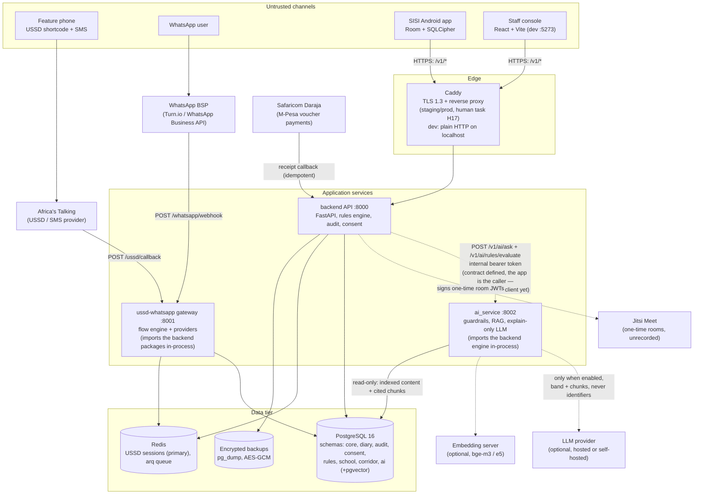
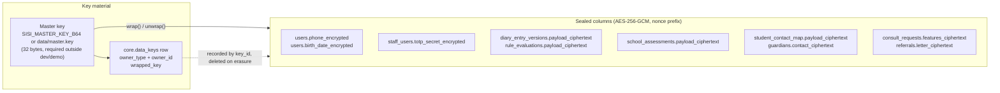
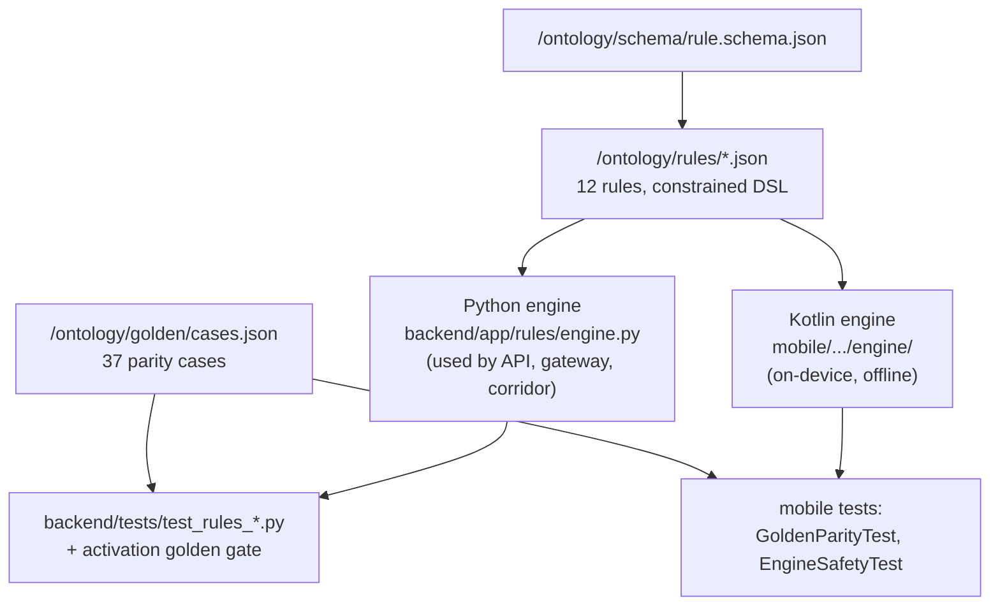
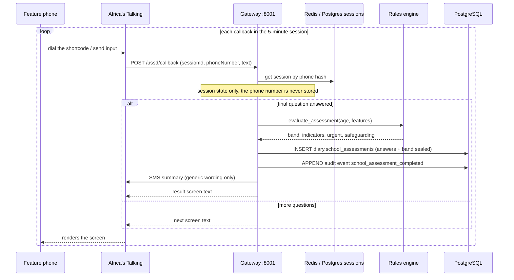
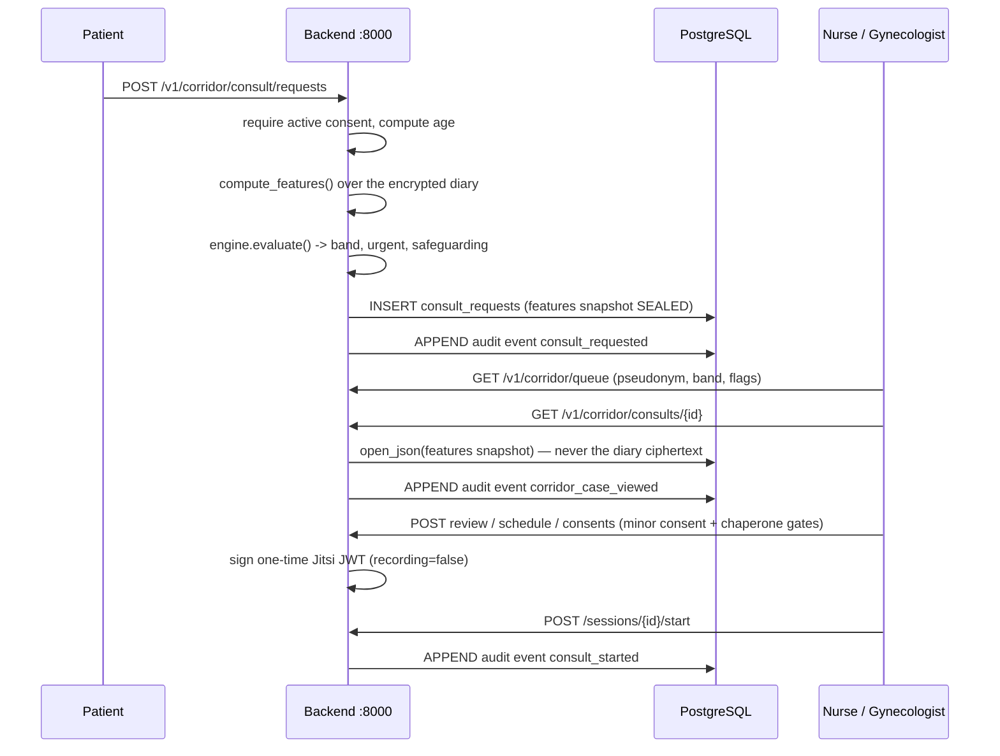
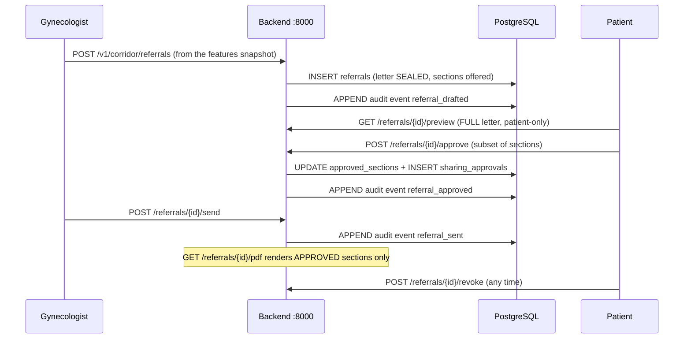
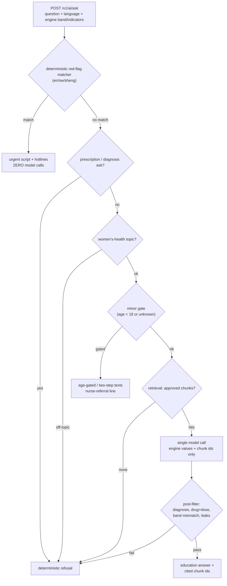

# Architecture

How SISI Health is put together: the services, the trust boundaries between
them, where encryption sits, why the rules engine exists twice, and what
happens in the four flows that matter. Everything here is read from the shipped
code — file paths are given so a reviewer can check.

Companion document: [`data-flow.md`](./data-flow.md) (the same system as a data
journey, with every encryption and audit point annotated).

## 1. Services

Ports: gateway **:8001**, backend **:8000**, AI service **:8002**, Vite dev
server **:5273** (proxying `/v1` to :8000), PostgreSQL **:5432**, Redis
**:6379** (`ussd-whatsapp/gateway/main.py`, `ai_service/ai_service/main.py`,
`web/vite.config.ts`, `web/playwright.config.ts`, `docker-compose.yml`).

The gateway runs its own FastAPI app and uses the **same** backend packages
(`app.rules`, `app.audit`, `app.crypto`, `app.models`) in-process — it is a
separate service and port, not a separate engine, and there is **no HTTP hop**
between the gateway and the backend. The AI service likewise imports the
backend's `RuleEngine`, `RedFlagMatcher`, settings, and audit helpers, so the
`/v1/ai/rules/evaluate` endpoint runs the real engine rather than a copy.

Start commands are not scripted in the repo: run the ASGI apps directly
(`uvicorn app.main:app --port 8000`, `uvicorn gateway.main:app --port 8001`,
`uvicorn ai_service.main:app --port 8002`). The Android **debug** build points
at the host through the emulator loopback (`http://10.0.2.2:8000`); the release
base URL is still a placeholder.

TLS: dev is plain HTTP on localhost. The staging/prod stack ships as
`docker-compose.prod.yml` (services `db`, `redis`, `backend`, `gateway`, `ai`,
`web`, `caddy`, with `staging`/`prod` profiles and healthchecks) plus
`deploy/Caddyfile`, which terminates **TLS 1.3 only** and reverse-proxies per
service. **No host exists yet** — provisioning and the first real deploy are
human task H17.

## 2. Trust boundaries

| Boundary | Crossing | Authentication / control |
|---|---|---|
| Carrier ↔ gateway | Africa's Talking callback | AT form contract (`sessionId`/`phoneNumber`/`text`); session keyed by **phone hash**, never the phone number; provider credentials are credential-guarded (H2). **No request-signature verification is implemented yet** — the gateway currently trusts any well-formed callback, which is acceptable only while it is dev/local and becomes a deploy-phase requirement (H17) |
| BSP ↔ gateway | WhatsApp webhook | provider contract (`{contacts, messages}`); same flow engine; generic wording only; same caveat about signature verification |
| App ↔ edge | user JWT (short-lived access + rotating refresh, device-bound) | TLS terminated at Caddy in staging/prod (H17); dev is HTTP on localhost. `FLAG_SECURE` + hidden app-switcher preview in release builds; release builds also pin `ALLOW_UNVALIDATED_RULES=false` |
| Console ↔ edge | staff JWT, 15-minute idle timeout, mandatory TOTP | tokens in `sessionStorage`, never `localStorage`; in dev the Vite proxy forwards `/v1` to :8000 so the browser never crosses an origin; CORS origins are explicit outside dev/demo |
| Edge ↔ services | private network | browsers never talk to the AI service or the DB directly |
| Gateway ↔ backend | **in-process** | the gateway imports `app.*` directly; no HTTP boundary exists, so there is nothing to authenticate between them |
| Backend / app ↔ AI service | `POST /v1/ai/ask`, `/v1/ai/rules/evaluate`, `/v1/ai/index` | **shared internal bearer token** (`SISI_AI_INTERNAL_TOKEN`, constant-time compare, prod-guarded, A35); the AI service is internal-only and its request schema **physically lacks** id/phone/name fields (A36). The contract is defined and gated; no in-repo HTTP client calls it yet — the app/gateway are the intended callers |
| Services ↔ LLM provider | HTTPS out | optional; receives the engine's band + indicator names + retrieved public chunks, **never identifiers or diary content** (A36); deterministic stubs in dev/demo, refused in staging/prod (A33) |
| Services ↔ DB | in-network | envelope-encrypted payload columns; master key from `SISI_MASTER_KEY_B64` or a file, required outside dev/demo |
| Operator ↔ backups | off-host backup files | `pg_dump` custom-format, AES-256-GCM-encrypted with the master key; `.backups/` is gitignored; restore is destructive and requires `--yes` |

Production guards (`backend/app/config.py`): staging/prod refuse to boot if
`SISI_ALLOW_UNVALIDATED_RULES` or `SISI_OTP_DEV_RETURN` is true, if the JWT
secret, phone pepper, or Jitsi secret is still the dev default, if the master
key is missing, or if `SISI_CORS_ORIGINS` is empty. Dev/demo keep the CORS
wildcard.

## 3. Data stores

| Store | Contents | Notes |
|---|---|---|
| PostgreSQL `core` | users, devices, refresh tokens, OTP requests, staff users, employers, data keys, config values, auth throttle, USSD session fallback, schools, school staff, students, contact maps, guardians, pharmacies (17 tables) | identity and access |
| `diary` | diary entries + versions, rule evaluations, erasure jobs, processing flags, school assessments (6 tables) | **separately encrypted**; append-only events |
| `audit` | `audit_events` | append-only, hash-chained by a DB trigger; UPDATE/DELETE raise |
| `consent` | consent texts, consent events, DSR requests, processing register (4 tables) | legal record |
| `rules` | rule versions + activations (2 tables) | approval state; partial unique index allows one active version per rule |
| `school` | assessment actions, guardian consents/alerts, vouchers, redemptions, wallets, wallet ledger, reconciliation reports (8 tables) | also holds employer wallets via `owner_type='employer'` |
| `corridor` | consult requests/events/sessions/consents, facilities, referrals, sharing approvals, surgery cases/events, pricing stubs, outcome logs, follow-up tracker, tracker events, reminders (14 tables) | computed-feature snapshots only |
| `ai` | content chunks + chunk embeddings (2 tables) | `vector(768)` + ivfflat when pgvector is available, else JSONB with Python cosine (CC-4) |
| Redis | USSD session state (primary), arq job queue | Postgres fallback (`core.ussd_sessions`) when Redis is absent (A19) |

Full column-level detail: [`data-dictionary.md`](./data-dictionary.md).

## 4. Encryption envelopes

Read this diagram with the **accuracy note** in
[`data-dictionary.md`](./data-dictionary.md) §Accuracy notes: today
`DatabaseKeyProvider.wrap()` seals payloads **directly under the master key**;
the per-owner `core.data_keys` row is recorded by `key_id` and is deleted by
the erasure pipeline, but its key material is not yet the layer that protects
the payload. Moving to true two-layer envelope sealing (and per-record
rotation) is a hardening item, not a description change.

What the encryption buys today, stated plainly: an exfiltrated database file
without the master key does not yield diary content, assessments, or corridor
snapshots; key material and the database must be separated for that to hold,
which is why the runbook treats "ciphertext plus key material exposed" as the
severity-raising case.

## 5. The rules engine exists twice, on purpose

- The Kotlin app does **not** ship rules inside the APK source: a Gradle `Sync`
  task copies `ontology/rules`, `golden`, `redflags`, and `schema` into the app
  assets on every build, so the device and the server read the same files.
- The same 37 golden cases run against both engines; a band that differs on
  either side fails CI (HZ-08).
- Rules become active in the DB only through the two-person workflow with a
  golden-suite gate (`backend/app/rules/service.py`), and the engine refuses
  unvalidated rules outside dev/demo. See
  [`rule-change-sop.md`](./rule-change-sop.md).
- Red-flag *text* patterns live in `/ontology/redflags/*.json` (en 22, sw 22,
  sheng 19) and are matched deterministically **before** any model call, in the
  AI service pipeline.

## 6. Key flows

### 6.1 School assessment (USSD / WhatsApp)

Age < 13 ends the flow with a blocked screen and stores nothing. The session
carries answers only for five minutes; after timeout the user restarts with no
residual data shown.

### 6.2 Corridor consult

### 6.3 Referral

### 6.4 AI ask (explain-only)

The order **is** the safety property: the urgent script and every refusal are
deterministic and bypass the model entirely; a model answer that fails the
post-filter is replaced by a deterministic refusal, so no unguarded model text
reaches a user (HZ-07). Implementation:
`ai_service/ai_service/service.py` (`ask()`), the step list in its module
docstring. The band shown to the user always comes from the engine — either the
one passed in on the request (contract-trusted between internal callers, A36) or
the one `/v1/ai/rules/evaluate` computes in-process; the AI service never has an
opinion of its own.

## 7. API surface and where the audit trail is written

The backend exposes **83 endpoints** under `/v1` (aggregated in
`backend/app/api/v1/router.py`): health 1, auth 6, staff auth 2, users 2,
consent 3, DSR 3, diary 2, rules 7, audit 2, admin 2, school 6, vouchers 4,
employer 7, corridor 36. Every one is behind JWT scope plus, for staff,
`require("<permission>")` RBAC — except `GET /v1/health`, the OTP/staff-login
endpoints (which authenticate by their own means and are rate-limited), and the
idempotent, receipt-keyed `POST /v1/vouchers/daraja/callback`. Patient-scoped
corridor routes (`/consult/requests`, `/referrals/{id}/preview|approve|revoke`,
`/tracking/me`, `/education/patient`) take the **user** token, not a staff role,
so a referral can only be approved by the woman it belongs to.

Every state change leaves an `audit.audit_events` row whose `prev_hash`/
`row_hash` are computed by a DB trigger under an advisory lock
(`audit.chain_insert()`), and the table rejects UPDATE and DELETE with
`audit.audit_events is append-only`. Notable event types: `diary_synced`,
`consent_granted`/`consent_revoked`, `erasure_completed`, `retention_purge_run`,
`school_assessment_completed`, `assessment_action`, `student_reidentified`,
`guardian_consent_recorded`, `consult_requested`, `corridor_case_viewed`,
`consult_started`/`consult_completed`, `referral_drafted`/`_approved`/`_sent`/
`_revoked`, `voucher_issued`/`voucher_redeemed`, `rule_version_registered`,
`rule_activation_requested`, `rule_activated`, `rule_rolled_back`,
`reminders_run`, `staff_login_locked`, `staff_totp_setup_locked`.

Payloads are sanitised before they are written (`sanitize_payload` redacts
`phone`, `name`, `email`, `symptoms`, `notes`, `diary`, `content`, `text`,
`message`, `answers`, `narrative`, `reason_text`, and any 9+ digit run):
counts, bands, flags, and ids only — never names, phone numbers, or symptom
content.

**What the chain does and does not detect.** The verifier recomputes the digest
in SQL with the same expression the trigger uses (so writer and verifier cannot
drift) and flags a row when its content hash mismatches, when the genesis anchor
was altered, or when a row's `prev_hash` differs from the previous row's
`row_hash` (`lag()` linkage). That catches **content edits and interior
deletion**. It does **not** detect **tail truncation** (deleting the newest
rows, or a `TRUNCATE` that bypasses the row-level triggers) — the remaining
chain is shorter but internally consistent. Treat "chain verified" as evidence
of no interior tampering, and keep off-host, hashed snapshots of the audit
table (the breach runbook's evidence rules) as the defence against truncation.

## 8. Operational shape

- One VPS for the pilot: `docker-compose.prod.yml` defines `db` (pgvector
  image), `redis`, `backend`, `gateway`, `ai`, `web`, and `caddy`, with
  `staging`/`prod` profiles and healthchecks; `deploy/Caddyfile` terminates
  TLS 1.3 and routes per service; `.env.prod.example` lists every prod-guard
  secret as empty. Nightly encrypted backups (`.\make.ps1 backup`) have a
  recorded restore drill. No host exists yet — provisioning and the first
  deploy are human task H17, and the one-command deploy scripts/runbook ship
  with the same ops workstream.
- Jobs run through arq: audit-chain verification, screening and follow-up
  reminder sweeps, and erasure/retention work. Each job opens its own session
  and records counts only.
- Observability is structured JSON logs with a PII scrubber: no diary content,
  no phone numbers, no names — ever.
