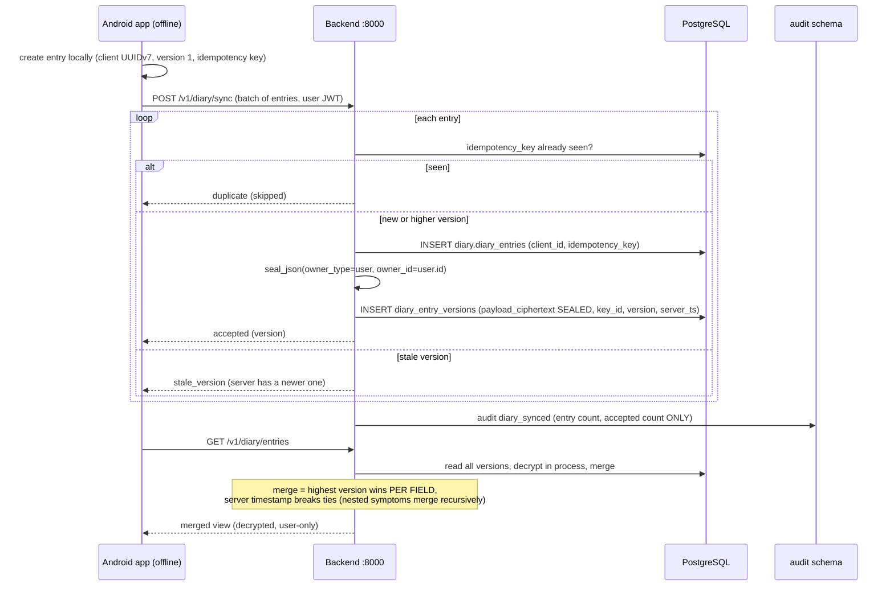
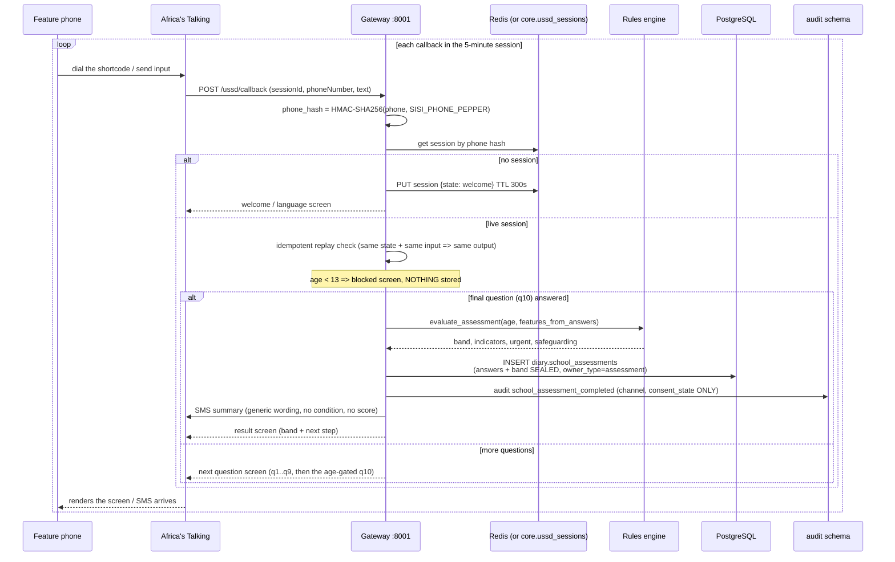
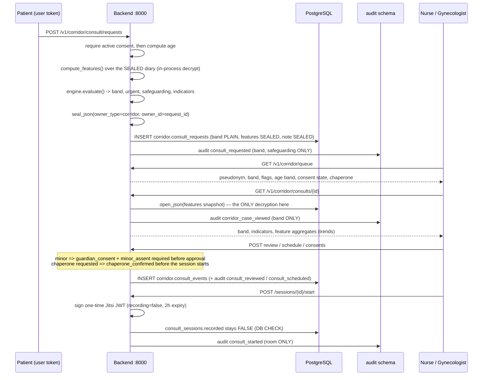
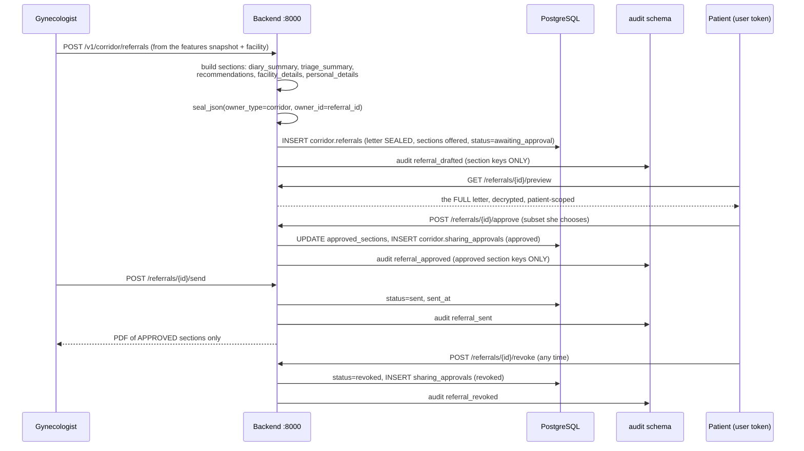
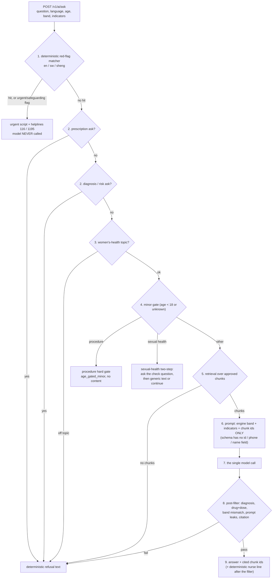
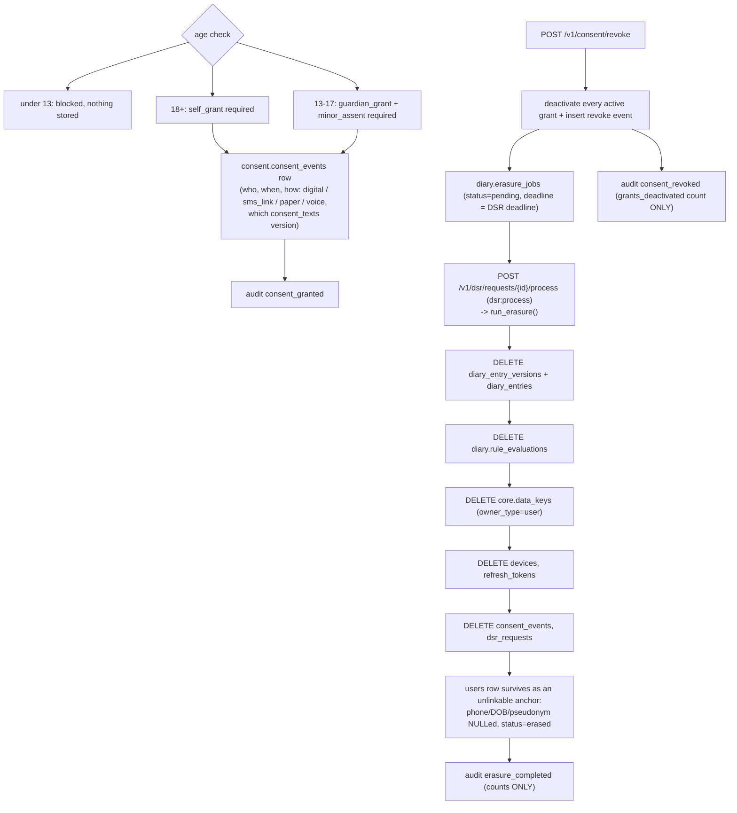
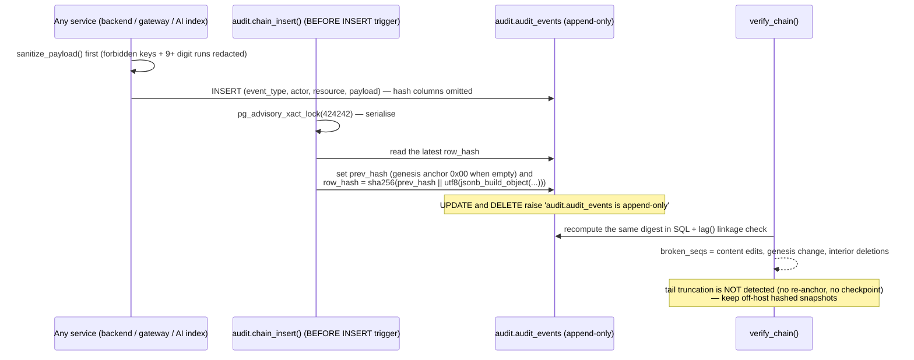

# Data Flow

The same system as [`architecture.md`](./architecture.md), told as the journey
of the data: what is created, where it is encrypted, who can decrypt it, what
is written to the audit trail, and what destroys it.

**How to read the diagrams.** Every diagram carries two kinds of annotation:

- 🔒 **sealed** — the payload is written as AES-256-GCM ciphertext (12-byte
  random nonce prefix) into a `*_ciphertext` column. Read the accuracy note in
  [`data-dictionary.md`](./data-dictionary.md) first: today the sealing is done
  with the **master key**, and the per-owner `core.data_keys` row recorded by
  `key_id` is not yet the second layer.
- 📝 **audit** — an `audit.audit_events` row is appended (hash-chained by a DB
  trigger). Payloads are sanitised: counts, bands, ids, flags — never content,
  names, or phone numbers.

Columns not marked are plaintext by design (ids, timestamps, bands, status
codes, hashes) — see the data dictionary for the column-by-column view.

## 1. Diary sync — encrypted, append-only, versioned

Why it is shaped this way: entries are **append-only events**; an edit is a new
version row, never an update, so a merge can never destroy data (hazard HZ-09).
The idempotency key makes carrier/app retries safe. The audit event records how
many entries arrived and how many were accepted — never what they contained.

**Derived data.** `compute_features()` decrypts the user's merged diary
in-process and derives the rule inputs (`max_pain_90d`, `avg_bleeding_volume_90d`,
`cyclical_pain_ratio_90d`, `fatigue_ratio_30d`, `cycle_irregularity_90d`, and
the boolean symptom signals) with the 90-day / 30-day windows. A missing input
stays `None` — the engine, not the extractor, applies the safety asymmetry.

**Evaluation.** `POST /v1/rules/evaluate` requires active consent, builds the
engine from `/ontology`, evaluates, and writes `diary.rule_evaluations`
(🔒 sealed: band, indicators, flags, rule-set version). No audit row is written
for routine evaluations — the evaluation row itself is the record.

## 2. USSD assessment — from a borrowed phone to a severity band

Facts that matter for privacy and safety:

- **The phone number is never stored.** Sessions are keyed by phone hash; the
  assessment row keeps `phone_hash`, `age_band`, `consent_state`, `language`,
  `channel`, and timestamps in plaintext, everything else sealed.
- **Answers are not asked that the channel must not ask.** The USSD/WhatsApp
  flow sets `self_harm_signal` and the cervical signals to `False` explicitly
  (never left missing), because a missing red-flag input would trigger the
  asymmetry and force RED/ORANGE for every subscriber. Those symptoms are
  detected on the app channel, in text conversations, or by a human.
- **The band comes from the engine**, via `evaluate_assessment()` — the same
  deterministic semantics as the diary path without the 14-day gate (CC-1,
  assumption A21).
- **Timeout privacy.** The session lives five minutes; after timeout the user
  restarts at the welcome screen with no residual data shown. `00` exits and
  deletes the session immediately.
- **The SMS carries no result.** Only "your health check results are ready"
  style wording (SPEC §3.5); the detail lives in-session and in the app.

**Downstream of an assessment (school module).** The nurse queue reads
pseudonym + band + age band + consent state + channel; recording an action
writes `school.assessment_actions` (sanitised note) and an audit
`assessment_action` row. Re-identification requires ORANGE/RED or a request for
contact, a typed reason (≥5 chars), and writes `student_reidentified` with the
reason; it is the only path that decrypts `core.student_contact_map`.
`POST /v1/school/guardian-alerts/run` sends **RED-only, generic** alerts, writes
`school.guardian_alerts` (`sent` / `failed` / `skipped_safeguarding`), and skips
the guardian entirely when the payload's `safeguarding` flag is set.

## 3. Corridor consult — the features snapshot, never the diary

The corridor is the one place where staff see more than a band — and even there,
**raw diary ciphertext is never opened by any corridor code path** (assumption
A30, non-negotiable 5). The case view is the *computed feature snapshot* sealed
at booking time, plus the band and the indicator names. Every view is audited,
which is what makes "who looked at this minor's case" answerable later.

Telehealth rooms are one-time (random room name per session), JWT-gated, and
cannot be recorded: the database CHECK `recorded IS FALSE` makes a recorded
session impossible to persist, and the room token claims
`features.recording = false`.

## 4. Referral — the patient approves every section

Two invariants are enforced in code, not by convention: the patient-scoped
routes take the **user** token (a staff role cannot approve on her behalf), and
the PDF endpoint returns `409` unless the referral is `approved` or `sent` and
renders **only** the approved section keys. Revocation is recorded as a
`sharing_approvals` row and an audit event; nothing silently un-shares.

Referral text never asserts a diagnosis — the triage section states the band and
the indicator phrases ("possible endometriosis pattern", "heavy bleeding with
dizziness") plus the standing disclaimer.

## 5. AI ask — the pipeline order is the safety property

Encryption and audit annotations for this flow:

- 🔒 **Nothing is sealed here because nothing patient-identifying is stored.**
  The AI service persists no conversation content; its request schema
  (`AskRequest`) has no id, phone, name, or email field by construction (A36).
- 📝 The only audit row from this flow is `ai_content_indexed`, written by
  `POST /v1/ai/index` (counts, mode, and model only — never chunk text).
- The retrieval store is `ai.content_chunks` + `ai.chunk_embeddings` (public
  education content, CC-BY 4.0). A **Sheng** question is served from the English
  library (`FALLBACK_LANGUAGE = "en"`).
- `request.urgent` or `request.safeguarding` set by the engine also forces the
  urgent script — the text matcher is not the only trigger.

## 6. Consent, revocation, and erasure

Things a reviewer should notice:

- Consent is **data**, not a checkbox: the row records the grant type, the
  capture method, the staff member who recorded it (nurse-assisted paths), an
  evidence reference, and the version of the consent text shown
  (`consent.consent_texts` with a content hash).
- Minors require **two** grants; a `self_grant` for a minor is refused, and a
  guardian grant for an adult is refused.
- Revocation deactivates grants immediately (processing stops), then schedules
  the erasure job; the job's deadline uses `SISI_DSR_DEADLINE_DAYS` (assumption
  A2, `TO CONFIRM` with counsel). The erasure itself runs through the DSR
  processing endpoint and destroys the ciphertexts, the evaluations, the data
  keys, the auth material, the consent events, and the DSR records — the user
  row survives only as an unlinkable anchor.
- **The audit trail is deliberately retained.** Its rows carry pseudonymous ids
  and sanitised payloads; once the keys and the pseudonym mapping are destroyed
  they identify nobody. That reasoning is documented in assumption A7 and is
  the lawful-basis argument counsel must confirm.

**Retention purge (scheduled, not user-driven).** `.\make.ps1 purge-retention`
(`backend/scripts/purge_retention.py` → `purge_retention_job`) deletes diary
entries and versions whose newest version predates `SISI_RETENTION_DIARY_DAYS`,
their stale rule evaluations, the user's data keys once no diary row or
evaluation remains, and expires lapsed vouchers
(`SISI_RETENTION_VOUCHER_DAYS`). It **never touches `audit.audit_events`**: the
append-only hash chain and an audit retention period are in conflict, so audit
rows are currently retained indefinitely and `SISI_RETENTION_AUDIT_DAYS` has no
automated effect — an open maintainer decision recorded in assumption A3 and
contract note CC-6. The script re-runs the chain verifier after the purge.

## 7. The audit chain itself

Entry points for verification: `.\make.ps1 audit-verify`
(`backend/scripts/verify_audit_chain.py`), `POST /v1/audit/verify`
(`audit:verify`), and the arq job `verify_audit_chain_job`. A break logs an
ERROR and returns the sequence numbers — alert on it; do not "repair" the chain.

## 8. Where each data class stops

| Data class | Reaches | Never reaches |
|---|---|---|
| Diary content | the user's own device and authenticated reads | school staff, corridor staff, the LLM, SMS, logs |
| Computed feature snapshot | corridor staff inside a consult case view (audited) | school staff; anybody outside the corridor |
| Assessment answers + band | the rules engine and the nurse queue (band only) | guardians, SMS, the LLM |
| Student identity | the re-identify endpoint (ORANGE/RED or contact request + typed reason, audited) | the queue, dashboards, exports |
| Guardian contact | the RED-only alert runner and the consent flow | the minor's diary views; any aggregate |
| Aggregates | school / employer / MoH dashboards through the shared k-anonymity module | anything below 5 per cell, or below 20 subjects at all |
| Audit rows | super-admin reads and the verifier | any diary content, name, or phone number (scrubbed at write time) |
